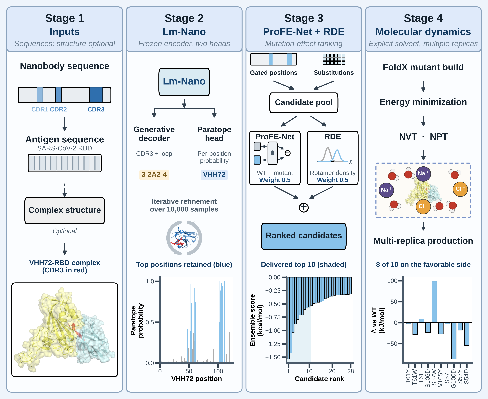

# LmPro-Nano

Nanobody mutation-site selection, mutation-effect ranking and CDR-H3 design
using pre-trained language and energy prediction models.

[Installation](#installation) · [Weights](#model-and-data-files) ·
[Data](#data-download-and-preprocessing) ·
[Inference](#quick-start-mutation-effect-scoring) · [Training](#training)



## Installation

Run from the repository root on Linux. Use separate environments for Lm-Nano
and ProFE-Net.

```bash
git clone --branch official https://github.com/tubic/LmPro-nano.git
cd LmPro-nano
```

### Lm-Nano

Tested with Python 3.10.20, PyTorch 2.6.0 and CUDA 12.4. Inference requires an
NVIDIA GPU.

```bash
python3.10 -m venv .venv
source .venv/bin/activate
python -m pip install --upgrade pip
python -m pip install torch==2.6.0 --index-url https://download.pytorch.org/whl/cu124
python -m pip install -r environment/requirements-main.txt
```

See the [recorded environment](environment/main-pip-freeze.txt) and
[system requirements](environment/SYSTEM_REQUIREMENTS.md).

### ProFE-Net mutation scoring

```bash
python3.10 -m venv .venv-profenet
source .venv-profenet/bin/activate
python -m pip install --upgrade pip
python -m pip install torch==2.6.0 --index-url https://download.pytorch.org/whl/cu124
python -m pip install torch-cluster==1.6.3 \
  -f https://data.pyg.org/whl/torch-2.6.0+cu124.html
python -m pip install -r profenet/requirements-inference.txt
```

For CPU use, replace the two wheel-install commands with:

```bash
python -m pip install torch==2.6.0 --index-url https://download.pytorch.org/whl/cpu
python -m pip install torch-cluster==1.6.3 \
  -f https://data.pyg.org/whl/torch-2.6.0+cpu.html
```

Scoring scripts select CUDA when available; use `--device cpu` to select CPU.

## Model and data files

Copy `checkpoints/` and `profenet/weights/` from the companion
`LmPro-Nano_Zenodo.zip` into this repository.

See [Lm-Nano checkpoints](checkpoints/release/README.md) and
[ProFE-Net weights](profenet/README.md#weights). Datasets, split lists and results
are not included.

## Data download and preprocessing

Run from the repository root in the environment for the relevant model.
Clustering requires MMseqs2; downloads use `curl`, `wget` and `rsync`.

| Data | Download | Preparation |
|---|---|---|
| INDI | [Provider](https://www.naturalantibody.com/indi2/) · [INDI 1.0](https://figshare.com/projects/INDI_-_Integrated_Nanobody_Database_for_Immunoinformatics/122022) | `pretrain-preprocess.sh` |
| SAbDab | [Structures](https://sabdab.opig.stats.ox.ac.uk/) | `tools/make_clustered_split.py` |
| SKEMPI 2.0 | [CSV and structures](https://life.bsc.es/pid/skempi2/database/index) | [ProFE-Net instructions](profenet/README.md#data-download-and-construction) |
| PDB-REDO | [Structures](https://pdb-redo.eu/download) | [ProFE-Net instructions](profenet/README.md#data-download-and-construction) |
| CoV-AbDab | [Database CSV](https://opig.stats.ox.ac.uk/webapps/covabdab/) | `abgnn/finetune/exp3-covabdab/split/split.py` |
| NbBench | [ZYMScott datasets](https://huggingface.co/ZYMScott) | `tools/download_nbbench_data.sh` |

### 1. INDI: paired tokens to binary inputs

Use INDI 1.0, including NGS sequences. Place six files named
`{train,valid,test}_3.{seq,tag}.tokens` under `abgnn/nano_data/`.
Each line contains a space-separated sequence or its residue tags
(`0`: framework; `1`/`2`/`3`: CDR1/2/3). Paired files must have equal line counts and matching token counts.
Raw-sequence annotation and the original partitions must be supplied separately.

```bash
TEXT=abgnn/nano_data DEST=abgnn/final_3_data DATA_VERSION=3 \
  bash pretrain-preprocess.sh
```

Outputs are fairseq binaries and dictionaries under `abgnn/final_3_data/{seq,tag}/`.

### 2. SAbDab: structure JSONL to clustered splits

Prepare JSONL records with `pdb`, `antibody_seq`, `antibody_cdr`,
`antibody_coords`, `antigen_seq` and `antigen_coords`. Tags must align with
antibody residues; coordinates use `[sequence_length, 14, 3]` in the model's
[atom14 order](fairseq_models/data/ab_dictionary.py). A general PDB-to-JSONL
exporter is not included.

Place the records in `abgnn/finetune/exp2-hern/nanobody/` as
`train_data.jsonl`, `valid_data.jsonl` and/or `test_data.jsonl`, then run:

```bash
python tools/make_clustered_split.py \
  --input-dir abgnn/finetune/exp2-hern/nanobody \
  --output-dir abgnn/finetune/exp2-hern/nanobody_clustered \
  --min-seq-id 0.6 --cov 0.8 --ratios 0.8 0.1 0.1 --seed 42
```

The script pools the inputs and writes new train/valid/test splits. For antigen
separation, use output directory `nanobody_antigen_disjoint_v2` and add
`--antigen-disjoint --antigen-min-seq-id 0.4 --antigen-cov 0.6`.

### 3. SKEMPI and PDB-REDO

See [ProFE-Net data preparation](profenet/README.md#data-download-and-construction)
for downloads and cache construction.

### 4. CoV-AbDab

Save a CSV with non-empty `CDRH3` values as
`abgnn/finetune/exp3-covabdab/split/covabdab.csv`, then run:

```bash
(cd abgnn/finetune/exp3-covabdab/split && python split.py)
```

This writes split labels to `dataset.txt`. Structure preparation is separate.
The helper creates and removes `tmp/`; run without an existing directory of that name.

### 5. NbBench

Requires Bash 4+ and `curl`:

```bash
HF_ENDPOINT=https://huggingface.co \
  OUTPUT_DIR=baselines/nbbench/data \
  bash tools/download_nbbench_data.sh
```

CSV splits and antigen embeddings are saved under `baselines/nbbench/data/<dataset>/`.

## Quick start: mutation-effect scoring

In the ProFE-Net environment, score a substitution on nanobody chain `H` bound
to antigen chain `A`:

```bash
python profenet/examples/predict_ddg.py \
  --pdb /path/to/complex.pdb --ligand-chains H --receptor-chains A \
  --mutations YH100W
```

Replace `YH100W` with `WT residue + chain + PDB residue number + mutant residue`
matching your structure. Use `HL` for a chain group and commas for a multi-mutant.
Residue numbers must be integers; insertion codes are not supported.

Outputs are per-fold predictions and their mean in kcal/mol.
ΔΔG = ΔG(mutant) − ΔG(wild type); negative values predict stronger binding.
Use `profenet/examples/predict_ddg_rde.py` with the same arguments for RDE.

## CDR-H3 design

In the Lm-Nano environment, run on the prepared test JSONL:

```bash
python inference.py \
  --cdr_type 3 \
  --cktpath checkpoints/release/lmpro_nano_clustered_seed128_epoch51.pt \
  --data_path abgnn/finetune/exp2-hern/nanobody_clustered \
  --split test --num_decode 10000 --topk 100 \
  --report_topks 1 10 100 1000 \
  --per_record_out cdr3_predictions.tsv --seed 128
```

The command reports sequence recovery and CDR-H3 structure metrics. To evaluate
a subset, add `--restrict_records /path/to/record_indices.txt` with zero-based
JSONL line indices. Metric definitions are in
[Training and evaluation](docs/REPRODUCIBILITY.md#inference).

## Training

After preparing the INDI binaries, activate the Lm-Nano environment and run:

```bash
bash run_pretrain_corrected.sh
```

Fine-tune on the prepared SAbDab splits:

```bash
LMPRO_ENV_BIN="$PWD/.venv/bin" \
  PRETRAINED_FILE=checkpoints/release/lm_nano_pretrain_u33000.pt \
  bash run_finetune_corrected_exp2.sh
```

Set `SEED` or `SPLIT` to change the run. Settings and split definitions are in
[Training and evaluation](docs/REPRODUCIBILITY.md). The 3-2A2-4 resampling loop
starts at [scripts/covid-optimize.sh](scripts/covid-optimize.sh).

## Citation

```bibtex
@unpublished{sun2026lmpronano,
  author = {Sun, Bo and Cao, Shuyuan and Gao, Feng},
  title = {LmPro-Nano: Pre-trained Language and Energy Prediction Models for Nanobody Optimization},
  year = {2026},
  note = {Manuscript under revision}
}
```

## License

See [Lm-Nano/ABGNN](docs/LICENSE), [ProFE-Net](profenet/LICENSE) and the licenses
in each `third_party/` project.
